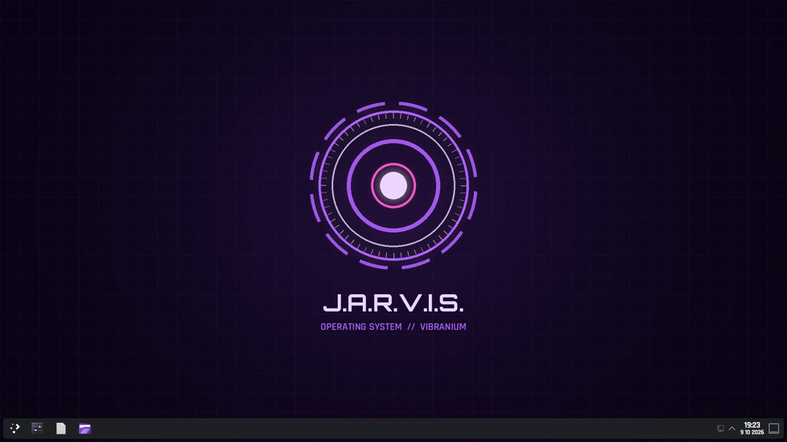

# JARVIS OS

J.A.R.V.I.S. as an operating system: Bazzite (KDE Plasma, Steam/Proton, NVIDIA open drivers) plus the JARVIS
layer, shipped as a signed bootc image so Tab can update it over the air. Dual-boots next to Windows and never
modifies Windows.

**📖 [How to get JARVIS: the tutorial](docs/TUTORIAL.md)** (Windows PC, build your own, dual-boot install)

## Get your own Tab

JARVIS works on its own: built-in commands plus a free **offline brain** (a local AI model, no account needed; see [docs/OFFLINE_BRAIN.md](docs/OFFLINE_BRAIN.md)).
Linking **Tab**, your own AI assistant that texts, browses and gets things done, adds the bigger jobs.
Get one with this invite: **[https://tab.bot/r/856A517B3CCACA47](https://tab.bot/r/856A517B3CCACA47)**

| Path | What |
|---|---|
| `image/Containerfile` | the OS image: `FROM ghcr.io/ublue-os/bazzite-nvidia-open:stable@sha256:…` + `build_files/build.sh` |
| `image/system_files/` | everything copied into the image: GRUB theme, Plasma colour scheme, wallpapers, fonts, systemd units, polkit, helpers |
| `image/disk_config/iso.toml` | installer ISO config for bootc-image-builder (never auto-partitions) |
| `jarvisd/` | the Linux JARVIS daemon (Python). `jarvisd/core/` is vendored verbatim from Windows JARVIS v5.1 |
| `windows/` | Windows-side "switch to JARVIS OS" (one-time firmware boot via bcdedit) |
| `bootdemo/` | builds a GRUB ISO with the real theme and boots it in QEMU/OVMF for a screenshot |
| `.github/workflows/` | nightly image build + test + push + cosign sign; installer ISO + release; boot, install, click-through, Rufus, NVIDIA and update tests |
| `cosign.pub` | public half of the image-signing key (the private half lives only in the repo's Actions secrets) |
| `tools/make_art.py` | regenerates wallpapers and boot art |

## Test

    cd jarvisd && QT_QPA_PLATFORM=offscreen python -m pytest -q tests      # 362 tests

## Status (1.0 release candidate, Oct 2026)

Release candidate **v1.0.0-rc5** (Oct 28: the Quest headset bridge and this week's Bazzite; rc1 Oct 16, rc2 + rc3 Oct 22, rc4 Oct 23). Every image goes through the same chain in virtual machines before it is released:
unit tests, a signed build, a boot test to the desktop, the NVIDIA boot settings check, the voice test, the
installer ISO booting from DVD and from a USB stick (UEFI + BIOS, and a Rufus ISO-mode stick), an unattended
dual-boot install and a click-through install next to a dummy Windows (Windows stays byte-identical), and the
update test (an older install receives the signed update, boots it, goes back through "previous (rollback)" in
the boot menu, and refuses an unsigned image).

**Not tested on real hardware yet**: the RTX 5060 driver and display, Secure Boot key enrollment on real firmware,
a physical USB stick, BitLocker, real disk sizes, microphones and RGB. The first real install follows
[docs/INSTALL_DAY_GUIDE.md](docs/INSTALL_DAY_GUIDE.md).

## Apps and games

- First login: `jarvis-first-boot-apps.service` installs `image/system_files/usr/share/jarvis-os/apps/flatpaks.list` from Flathub (per user, retried at the next login if anything fails).
- "Jarvis, restore my games" (or the *Restore my games* menu entry, or `jarvisctl games restore`) mounts the Windows drive **read-only**, reads its Steam libraries, skips games that only run on Windows (`steam-compat.json`), and queues the rest so Steam downloads them on its next start. Launch-option tweaks (e.g. Marvel Rivals' `SteamDeck=1 %command%`) are printed. No game list ships in the image; it is read from your own library.

## Gaming & streaming

Bazzite already brings GameMode, gamescope, MangoHud, OBS game-capture hooks, sched_ext schedulers, tuned power profiles, zstd zram and the big `vm.max_map_count`. JARVIS OS adds:

| Say | What happens |
|---|---|
| **"game mode"** / **"game mode off"** | Switches to the *performance* power profile and back. Optional: the `scx_lavd` gaming scheduler, if `gaming.game_scheduler: lavd` is set in the config. |
| **"stream mode"** / **"stream mode off"** | Game mode, plus lower audio latency (PipeWire quantum 256), held notifications and a paused file indexer. All of it reverses. |
| **"gaming check"** | Reads the GPU and driver, Resizable BAR (BAR1 vs VRAM), power profile, GameMode, scheduler, and display mode + VRR. |
| **"set up my monitor"** | Native resolution, highest refresh rate, adaptive sync on *automatic*. This also runs once at first login. |
| **"turn on HDR"** / **"HDR off"** | Opt-in. HDR on RTX 50-series has open driver reports, so test it yourself. |

Built in: Proton gets DLSS/Reflex (`PROTON_ENABLE_NVAPI=1`) and the DLSS updater, plus a 10 GB NVIDIA shader cache that is never trimmed. MangoHud is set up but hidden; add `mangohud %command%` to a game's launch options and press **Right Shift + F12**. There's an OBS **JARVIS Stream** profile: NVENC H.264 6000 kbps 1080p60 for streaming, NVENC AV1 for recordings, and a 30 s replay buffer. Discord screen share goes through the KDE portal, and **Vesktop** carries audio. For per-game boosts add `gamemoderun %command%`.

*None of this has been tested on real hardware yet.*

## Updates and signing

Every push to `main` (and a nightly run) builds `ghcr.io/<owner>/jarvis-os:beta`, pushes it, and signs it with cosign.
The image ships `cosign.pub` and a `policy.json` entry, so `bootc upgrade` only accepts images signed with this key.

## Licences

JARVIS OS's own code: MIT. Fonts: SIL OFL (see `image/system_files/usr/share/fonts/jarvis`). Wake-word models: see
`image/system_files/usr/lib/jarvis-os/models/openwakeword/NOTICE.md`. Base image: Bazzite (Universal Blue).

## Safety promises

- The installer never auto-partitions and nothing here ever writes to the Windows partition.
- Tab remote control is off unless the owner turns it on, always shows a "TAB IS DRIVING" bar, and
  Meta+Shift+Esc or "take back control" ends it instantly. Purchases, messages and destructive actions always ask first.
