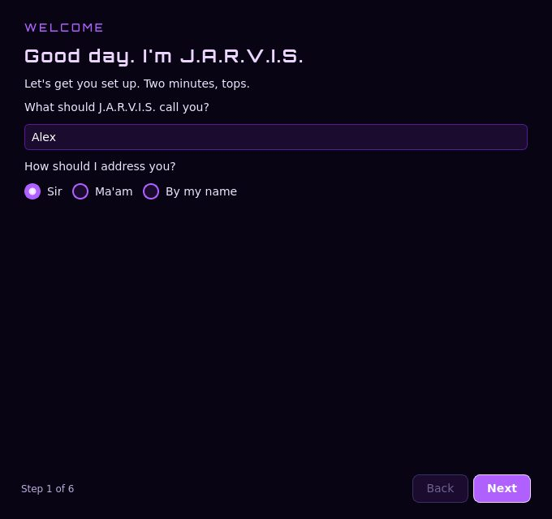
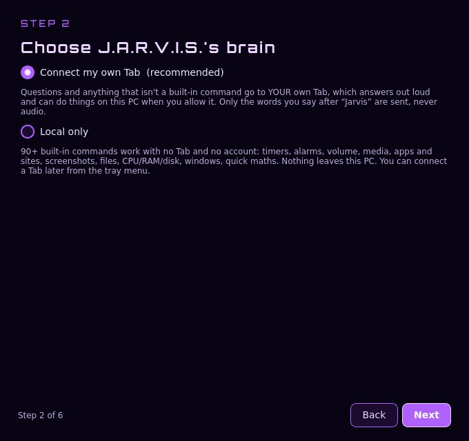
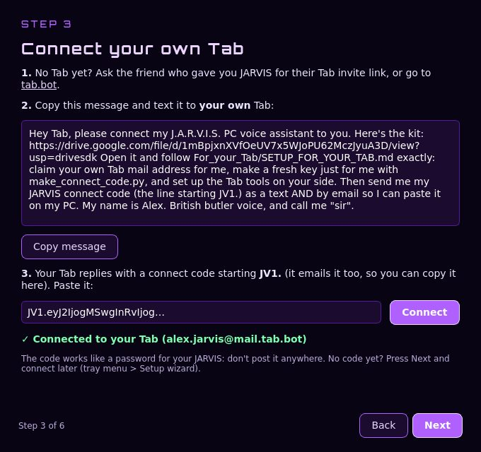
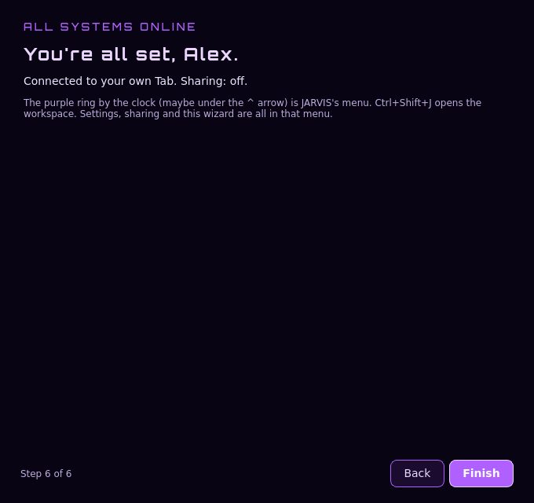
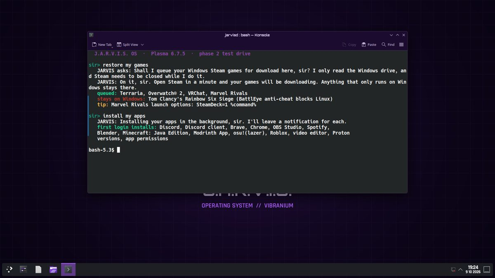
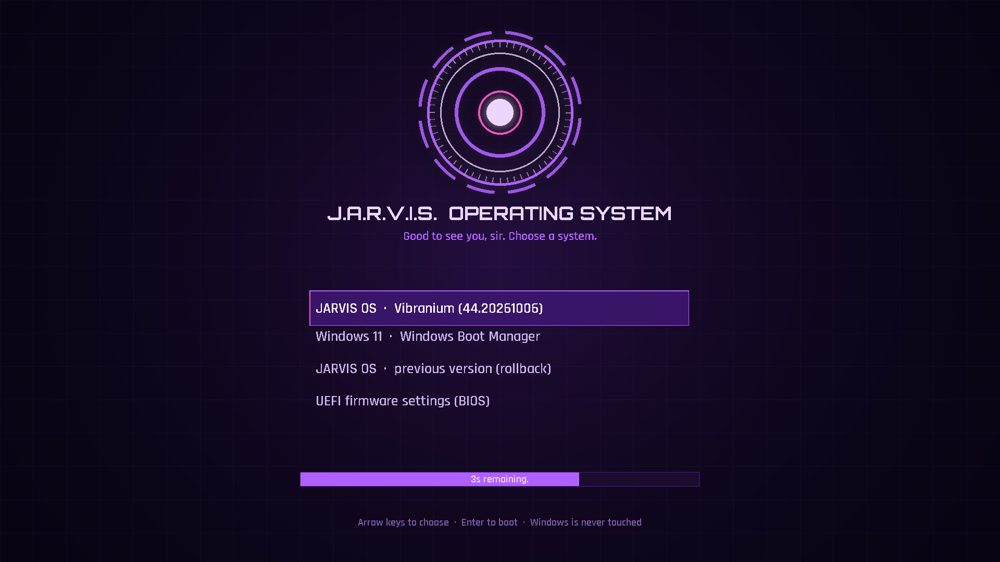

# How to get J.A.R.V.I.S.

Three ways in, from easiest to hardest:

1. **[JARVIS on a Windows PC](#1-jarvis-on-a-windows-pc)**: about 15 minutes, nothing to build.
2. **[Build your own JARVIS OS](#2-build-your-own-jarvis-os)**: fork this repo and GitHub builds it for you.
3. **[Install JARVIS OS next to Windows](#3-install-jarvis-os-next-to-windows-dual-boot)**: ⚠️ *not released yet, coming by Oct 31 2026.*

> **You'll want your own Tab.** Tab is the AI that JARVIS asks when a question isn't a built-in command.
> Get one here: **[https://tab.bot/r/856A517B3CCACA47](https://tab.bot/r/856A517B3CCACA47)**

---

## 1. JARVIS on a Windows PC

**You need:** Windows 10 or 11, a microphone, and internet for the first install.

| | |
|---|---|
| ⬇️ **Download** | [JARVIS_Friend_v5.1.zip](https://drive.google.com/file/d/1mBpjxnXVfOeUV7x5WJoPU62MczJyuA3D/view?usp=drivesdk) (about 4 MB, no one else's keys or data inside) |
| 📱 **Picture guide (PDF)** | [JARVIS Friend Tutorial](https://drive.google.com/file/d/1UxBXvbQsOVoenOkilmht2GioFy65nz0k/view?usp=drivesdk), 27 phone-sized pages |

**Steps**

1. Open the download link and tap **Download**. If Drive says it "can't scan for viruses", tap **Download anyway**.
2. Go to **Downloads**, right-click the zip, then **Extract All > Extract**.
3. Open **JARVIS_Friend_v5.1 > JARVIS** and double-click **setup.bat**.
4. If Windows says "Windows protected your PC", click **More info**, then **Run anyway**. Click **Yes** if it asks to allow changes.
5. Leave the black window open for **5–10 minutes**. It installs Python pieces and downloads the voice once. The city for weather is optional; press Enter to skip it.
6. The purple **Setup wizard** opens:

<p>


</p>

   - **Welcome**: your name, and how JARVIS should address you.
   - **Brain**: pick **Connect my own Tab** (recommended), or **Local only**, where the 90+ built-in commands work with no Tab at all.

7. **Connect your own Tab:**
   1. No Tab yet? Get one: **[https://tab.bot/r/856A517B3CCACA47](https://tab.bot/r/856A517B3CCACA47)**
   2. Press **Copy message** and text it to **your own** Tab.
   3. Tab texts and emails back a **connect code** starting with `JV1.` Paste it in and press **Connect**. Keep it secret, because it works like a password.

<p>


</p>

8. **Microphone**: Windows Settings > Privacy & security > Microphone. Turn on **Microphone access** and **Let desktop apps access your microphone**.
9. Say **"Hey Jarvis"**, wait for the chime, then talk: *"set a timer for 10 minutes"*, *"what can you do"*, *"open Spotify"*, *"take a screenshot"*. The tray icon is the purple ring by the clock, and **Ctrl+Shift+J** opens the workspace.

**Sharing is off.** The setup has an optional "share with the friend who gave you JARVIS" page: a check-in and a daily transcript. Both start OFF. Each one turns on only after a consent screen, a purple badge shows while it's on, and the tray's **Stop sharing** ends it in one click.

**If something breaks:** for no sound, say *"Jarvis, test sound"* or use tray > Restart. If it doesn't hear you, check the mic toggles above and try tray > Wake sensitivity > High. If antivirus blocks it, go to Windows Security > Protection history > Allow, then run setup again. Crash logs are in `%LOCALAPPDATA%\JARVIS-data`. To remove JARVIS, run `uninstall.bat`.

---

## 2. Build your own JARVIS OS

JARVIS OS is [Bazzite](https://bazzite.gg) (Fedora, KDE Plasma 6, Steam/Proton, NVIDIA drivers) plus the JARVIS layer. GitHub builds it as a signed image.



<sub>A real KDE Plasma 6.7.5 session with the JARVIS theme and jarvisd. It was captured on a Linux test box, not on the finished image.</sub>

1. **Fork** this repo (top right, **Fork**).
2. Make a signing key on any computer with [cosign](https://docs.sigstore.dev/cosign/system_config/installation/) (press Enter for an empty password):
   ```
   cosign generate-key-pair
   ```
3. In your fork, go to **Settings > Secrets and variables > Actions > New repository secret**. Name it `SIGNING_SECRET` and paste the whole of `cosign.key`. Then replace `cosign.pub` in the repo with your new one. **Never commit `cosign.key`.**
4. Go to **Actions**, enable workflows, and run **build-jarvis-os**. It runs the tests, then builds, pushes and signs `ghcr.io/YOUR-NAME/jarvis-os:beta`. That takes about 30–40 minutes.
5. Make the image public: **your profile > Packages > jarvis-os > Package settings > Change visibility > Public**.
6. Optional: run **build-iso** to get an installer ISO as a download.

Want to change something? The theme lives in `image/system_files/`, the apps installed at first login in `image/system_files/usr/share/jarvis-os/apps/flatpaks.list`, and the voice commands in `jarvisd/`. Run the tests with:
```
cd jarvisd && QT_QPA_PLATFORM=offscreen python -m pytest -q tests
```

---

## 3. Install JARVIS OS next to Windows (dual-boot)

> ⚠️ **NOT RELEASED YET. Coming by Oct 31 2026.** None of this has been tested on real hardware yet. Don't try it on a PC you can't afford to mess up until the release says it's ready.



**The promise:** JARVIS OS never erases or changes Windows. You pick a system every time you turn the PC on.

**Printable version:** the [install-day checklist](INSTALL_DAY.md).

1. **Back up.** The best backup is a full *system image* on an external drive: Control Panel > Backup and Restore (Windows 7) > **Create a system image**. Also copy anything you'd hate to lose to the cloud.
2. **Save your BitLocker recovery key** if Windows has one: [aka.ms/myrecoverykey](https://aka.ms/myrecoverykey).
3. **Turn off Fast Startup** in Control Panel > Power Options > Choose what the power buttons do.
4. **Make room**: right-click Start > **Disk Management**, right-click **C:** > **Shrink Volume**. **150 GB** for JARVIS OS is plenty, since games can live on either side. Make sure Windows still has **at least 100 GB free** afterwards. Leave the new space *unallocated*.
5. **Make a USB stick** (8 GB or more) from the JARVIS OS ISO with [Fedora Media Writer](https://fedoraproject.org/workstation/download) or Rufus (use DD mode). This **erases the USB stick**, not your PC.
6. **Boot from USB**: restart and tap the boot-menu key. On ASRock and MSI boards that's usually **F11**. Pick the USB.
7. In the installer, choose **Installation destination > the unallocated space only**. **Never** pick "erase disk" or the Windows partitions.
8. **Secure Boot**: on the first boot a blue screen asks to enroll a key. Pick *Enroll MOK* and type the password Bazzite's docs give, `universalblue`.
9. **Done.** The JARVIS boot menu shows JARVIS OS and Windows. On JARVIS OS, *"Jarvis, switch to Windows"* restarts into Windows once. On Windows, `windows/Switch-To-JarvisOS.ps1` does the reverse.

**After the first login:** JARVIS installs your apps (Discord, Brave, OBS, Spotify and more) in the background. Then say **"Jarvis, restore my games"**: it reads your Windows Steam library *read-only*, skips games that only run on Windows, and queues the rest to download.

**Gaming & streaming:** say *"game mode"* before you play and *"stream mode"* before you go live. *"Gaming check"* tells you what's tuned. In BIOS, turn on **Re-Size BAR** and **Above 4G Decoding**. See the [README](../README.md#gaming--streaming) for everything that's tuned.

**Already on Bazzite?** You can switch without reinstalling: `sudo bootc switch ghcr.io/OWNER/jarvis-os:beta`, where OWNER is the lowercase GitHub name of the repo you're using. `sudo bootc rollback` takes you back.
